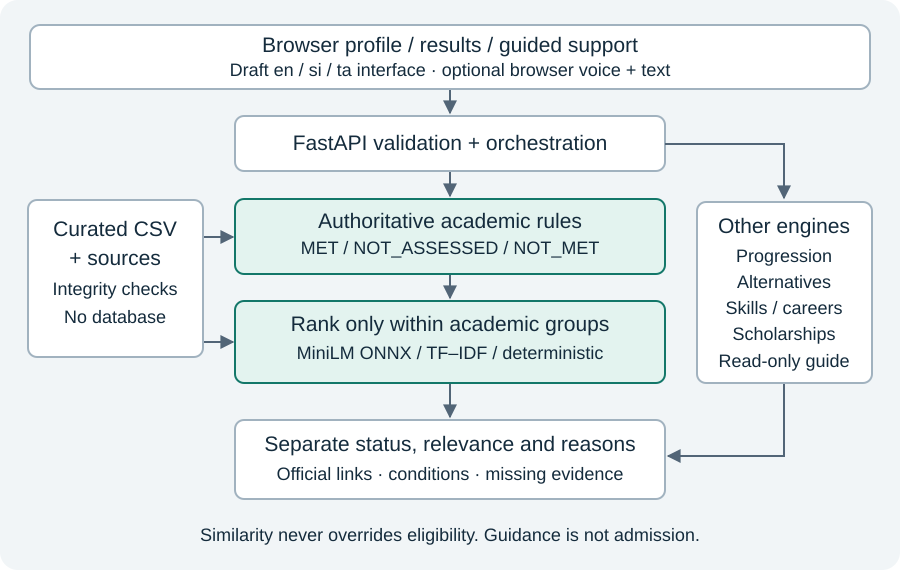

<!-- Generated by tools/build_draft.py; edit chapter/appendix source files. -->

## Draft contents

- [00-front-matter](chapters/00-front-matter.md)
- [01-introduction](chapters/01-introduction.md)
- [02-literature-review](chapters/02-literature-review.md)
- [03-methodology-ethics](chapters/03-methodology-ethics.md)
- [04-requirements-design](chapters/04-requirements-design.md)
- [05-architecture-implementation](chapters/05-architecture-implementation.md)
- [06-knowledge-base](chapters/06-knowledge-base.md)
- [07-hybrid-recommendation](chapters/07-hybrid-recommendation.md)
- [08-testing-evaluation](chapters/08-testing-evaluation.md)
- [09-results-discussion](chapters/09-results-discussion.md)
- [10-conclusion-future-work](chapters/10-conclusion-future-work.md)
- [REFERENCES](REFERENCES.md)
- [A-approved-baseline](appendices/A-approved-baseline.md)
- [B-catalogue-evidence](appendices/B-catalogue-evidence.md)
- [C-architecture-diagrams](appendices/C-architecture-diagrams.md)
- [D-observed-rankings](appendices/D-observed-rankings.md)
- [E-evidence-index](appendices/E-evidence-index.md)

---

# WiseLanka
## An AI-powered, policy-aware education and career pathway intelligence prototype for Sri Lankan learners

University of West London — final-year project

**First complete working draft — 29 October 2026. Not approved for submission.**

Author/student number: [AUTHOR TO COMPLETE]. Course/module, supervisor, word limit, required cover sheet and submission date: [OFFICIAL BRIEF REQUIRED]. This document uses the approved excerpts supplied by the author. The original DOCX and institutional instructions have not been inspected. November dates are project targets, not the dates on which evidence was collected.

### Abstract

WiseLanka investigates how a bounded web prototype can combine explicit educational requirements with personalised programme exploration. Its curated CSV knowledge base contains 11 programmes across Information Technology, Business and Management, and Engineering, including vocational progression. A FastAPI backend separates authoritative academic rule assessment from relevance ranking. Outcomes distinguish MET, NOT_MET and NOT_ASSESSED. A frozen pretrained MiniLM sentence encoder performs local ONNX inference; TF–IDF and deterministic ordering provide comparison methods. Guided support, draft English/Sinhala/Tamil interface strings and optional browser speech input extend interaction without allowing conversational or relevance outputs to alter academic rules.

At the WP5 checkpoint, 205 backend tests, 36 browser tests, five live integration workflows and 14 implementer-authored synthetic reference cases passed. Integrity checks and a fresh optional-AI installation succeeded. Automated accessibility scans detected no violations in nine tested states after targeted corrections. A nine-scenario ranking comparison was completed, but independent relevance judgements were unavailable. No ranking-quality improvement, satisfaction score or learner-outcome benefit is claimed. Adult usability evaluation, fluent translation review and native speech/assistive-technology testing remain pending. The resulting contribution is a reproducible, evidence-aware prototype and a documented evaluation design; the broader research claim remains provisional.

### Author review and assistance disclosure

This draft was prepared with AI assistance from Codex using repository inspection and checked sources. It must not be represented as wholly unaided student writing. The author must review sources, revise and take responsibility for the analysis, and confirm permitted assistance and disclosure requirements against the actual assessment brief. A module-specific permission or declaration has not been verified. No declaration of originality or ethical approval is signed or fabricated here. Personal reflection, acknowledgements and approved institutional wording must be written/confirmed by the author.

### Reading guide

Chapters 1–10 provide a continuous dissertation argument. References and appendices follow. “Measured” refers to saved technical observations; “synthetic” refers to fictional profiles; “mocked” refers to simulated browser/API events; “pending” denotes work not performed. Bibliographic style is provisionally author–date and must be reconciled with the actual university instructions. The companion deliverable inventory records academic blockers.

---

# 1. Introduction

## 1.1 Problem and context

Education-to-career guidance must answer several different questions: which recorded entry requirements a learner meets, what evidence is missing, which programmes relate to stated interests, and what alternative routes remain conditional. Conflating these questions can produce plausible but misleading recommendations. A similarity score cannot determine whether an examination condition has been met, and an unreported qualification does not establish its absence.

Sri Lanka provides a concrete setting involving university and vocational routes. The National Education Commission's historical career-guidance study establishes that guidance provision has been a policy research concern; its 2014 series report, first published in 2016, is not evidence of current nationwide prevalence or of WiseLanka user needs (National Education Commission, 2016). The present project instead uses a small documented programme catalogue to investigate a defensible technical response. Its developer motivation is recorded in docs/research/A2_DOMAIN_MODEL.md, but personal experience is not presented as representative empirical research.

The practical problem addressed here is the combination of distributed educational conditions, incomplete learner evidence and preference-based exploration in one explainable prototype. WP5 source review supplied a concrete example: A/L subject passes were insufficient to resolve all UGC general-entry and selection conditions. This finding motivates explicit uncertainty rather than an optimistic eligible/not-eligible shortcut. It does not establish that existing commercial guidance systems universally lack these safeguards.

## 1.2 Approved aim and objectives

The approved aim is: “The aim of this project is to design, develop, and evaluate an AI-powered, policy-aware Education and Career Pathway Intelligence System that provides personalised, explainable, and accessible education and career guidance for Sri Lankan learners.”

The eight approved objectives are reproduced without alteration in appendix A, together with FR1–FR9. In this dissertation they connect literature/problem investigation (I–II), structured knowledge and hybrid recommendation (III–IV), a usable web artifact (V–VI), and evaluation/limitations (VII–VIII). Implementation evidence is strongest for III–V; human and language/accessibility validation is incomplete. A functional prototype alone cannot establish attainment of the whole research aim.

## 1.3 Approved research questions

**MAIN RESEARCH QUESTION**

How can an AI-powered, policy-aware Education and Career Pathway Intelligence System support Sri Lankan learners through personalised, explainable, and accessible pathway recommendations?

**SUPPORTING RESEARCH QUESTIONS**

I. How can learner profiles, eligibility requirements and pathway knowledge be integrated to generate suitable recommendations?

II. How can explainable recommendation mechanisms improve user understanding and trust?

III. How can alternative pathway generation and skill-gap identification support educational and career planning?

IV. How can multilingual support, mobile usability and voice-assisted input improve accessibility?

V. How effective is the prototype in providing relevant and usable pathway guidance?

These exact questions were supplied by the author during the academic alignment review. They are accepted baseline excerpts; the original proposal DOCX has not been inspected. MRQ denotes the main question and SRQ-I–V denote the supporting questions, distinct from objective numbers. The [research-question traceability](RESEARCH_QUESTION_TRACEABILITY.md) maps each question to components, methods, evidence and remaining work. Questions concerning improvement, relevance and usability do not yet have empirical answers.

## 1.4 Scope and intended contribution

Target users are A/L learners, vocational learners and early-career users. O/L results support relevant entry routes. Initial domains are IT, Business and Management, and Engineering. The delivered catalogue has seven IT, one Business and three Engineering programmes; it is deliberately uneven and cannot support national coverage claims. Nationwide production deployment, full national education coverage, advanced deep-learning predictive modelling and unrestricted conversational AI are outside the approved scope. Accounts and durable profile storage were not implemented because no demonstrated requirement justified them.

The contribution is an integrated artifact in which sourced constraints, learner self-reports and AI-derived relevance remain distinguishable. A second contribution is an auditable evaluation record that exposes where software behaviour has been verified and where educational accuracy, relevance or usability still requires independent work. This is an application/design contribution, not a new embedding algorithm or a claim to have solved career decision-making.

## 1.5 Dissertation structure

The literature chapter establishes the choice of constraints, content similarity and multidimensional evaluation. Methodology connects iterative artifact construction to Design Science Research. Requirements, implementation and knowledge construction explain what was actually built. The evaluation and discussion chapters interpret saved evidence and identify limits. The final chapter states bounded conclusions and prioritises future work.

---

# 2. Critical literature review and research gap

## 2.1 Review approach and evidential limits

This is a focused narrative review, not a completed systematic review. WP6 searches on 29 October 2026 targeted original publisher/proceedings pages, research-commission publications and model documentation. Topics included educational recommenders, hybrid recommendation, sentence embeddings, explanations and evaluation. The source register records URLs, access scope and barriers. Some works were available only as publisher abstracts: those are used for high-level claims, not detailed methodological appraisal. No search-result counts, screening flow, inter-rater agreement or exhaustive coverage is invented. The author should expand database searches and full-text appraisal through the university library before finalising Objective I.

## 2.2 Educational recommendation and learner agency

Deschênes (2020) reviews 56 studies concerning learner agency and distinguishes accuracy, satisfaction and learning-performance evaluation. This distinction is valuable because an algorithm can retrieve related content without helping a learner make a justified decision. The review concerns learning contexts rather than Sri Lankan admission decisions, so direct transfer of findings would be inappropriate. WiseLanka therefore preserves exploration and official links rather than presenting its order as a uniquely correct pathway.

Da Silva et al. (2023), whose publisher abstract was checked, report that hybrid approaches were prominent in their selected studies while pedagogical effectiveness received less evaluation attention. Their sample and time window limit generalisation. The implication for this project is methodological: functional success and ranking comparisons should be accompanied by separate relevance and human-comprehension protocols. This does not establish that WiseLanka improves education or that hybridity itself produces benefit.

## 2.3 Explicit constraints and hybrid recommendation

Burke (2002) examines combinations of recommendation techniques. The useful principle here is that different mechanisms can address different weaknesses. WiseLanka adopts a constrained sequence: formal rules establish an academic assessment group, and content similarity influences exploration within that group. It is not a weighted blend in which high semantic similarity compensates for a failed entry requirement. Unlike interaction-based recommendation, this design can operate without historical preference data; its trade-off is dependence on manually curated descriptions and rules. The publisher abstract supports the general hybrid framing, not a claim that Burke evaluated this implementation.

Pure eligibility filtering would be transparent but insensitive to paraphrased interests. A purely semantic system could retrieve attractive programmes with unmet or unknown conditions. Collaborative filtering was considered inappropriate for this dataset because no legitimate interaction/rating matrix exists. Artificial feedback would allow code experimentation but would not supply evidence of learner preferences. These are project-specific design judgements, not empirical rankings of all algorithms.

## 2.4 Lexical and semantic content matching

Salton and Buckley (1988) establish term weighting as a retrieval baseline. TF–IDF is useful here because its vocabulary matches can be inspected and its corpus is small. Its limitation is lexical dependence: related intentions need not share programme words. WiseLanka implements a declared smoothed-IDF variant and cosine comparison; it does not assert exact replication of every weighting scheme in that paper.

Reimers and Gurevych (2019) introduce sentence representations compared with cosine similarity. This motivates testing contextual embeddings for paraphrased interests. Their reported benchmark results concern their own experimental tasks and do not transfer as accuracy figures for WiseLanka. The deployed model's learned representation is externally pretrained; the project only performs frozen inference. Its ability to produce nonidentical vectors for paraphrases is not evidence that a particular programme is educationally suitable.

Wang et al. (2020) investigate attention-based distillation for smaller Transformer models. Their work supports the rationale for a lightweight encoder, but is not itself a validation of this specific sentence-transformer export or educational use. WiseLanka's actual runtime, revision and checksum-locked artifacts are evaluated locally. English semantic input is retained even when interface controls switch language. No Sinhala/Tamil semantic understanding is inferred from interface translation.

## 2.5 Explanations, understanding and persuasion

Tintarev and Masthoff (2012) distinguish several explanation goals and caution that they may conflict. The publisher abstract describes effectiveness/satisfaction trade-offs in movie and camera studies; these domains do not prove educational effects. The important design implication is to measure whether a learner understands missing evidence and conditional progression, rather than treating a persuasive explanation as accurate. WiseLanka's source links and status reasons expose evidence, but its similarity explanation is a description of the matching method, not a faithful attribution of each embedding dimension.

The proposed explanation questions separately test recognition of NOT_ASSESSED, admission uncertainty and self-reported competence. Agreement with a statement such as “the explanation was clear” is weaker than correctly explaining a condition in a task. Both observations should be retained and disagreements discussed.

## 2.6 Local guidance context and accessibility

The NEC report provides historical context for career-guidance research (National Education Commission, 2016). It cannot establish that the selected 11 programmes represent contemporary learner demand. Independent adult needs/usability evidence and review of current policy remain important. A prototype which centralises information also risks amplifying curation bias: seven IT programmes have more opportunities to appear than the single Business programme.

WCAG supplies testable accessibility criteria (W3C, 2024). Automated checks detect some implementation faults but cannot establish all interaction or language-quality requirements. Accordingly, WiseLanka combines measured automated scans with pending manual keyboard, screen-reader, zoom and fluent-language review. Interface availability should be distinguished from practical accessibility for a particular person and browser.

## 2.7 Evaluation and the bounded research gap

Järvelin and Kekäläinen (2002) motivate graded, position-sensitive retrieval evaluation. The proposed nDCG protocol is appropriate only when legitimate relevance judgements exist; its numerical precision would otherwise conceal invented labels. The study uses a stated exponential-gain variant and within-group candidate pools, rather than assuming every nDCG formulation is identical.

The gap addressed is therefore a local design/evaluation problem: can a small, source-aware prototype keep policy assessment, missing evidence and semantic relevance separate while supporting practical pathway exploration? It is not a claim that no earlier system combines rules and AI. The current artifact demonstrates those separations in tested cases; independent relevance and usability work is needed to determine whether learners find the resulting guidance useful.

## 2.8 Synthesis of alternatives

| Approach | Potential value | Limitation for this project | Decision |
|---|---|---|---|
| Rules alone | Explicit requirements, traceable reasoning | Limited preference interpretation | Retain as authority and baseline |
| TF–IDF | Reproducible lexical comparison | Synonym/paraphrase sensitivity | Implement comparison |
| Frozen embeddings | Pretrained semantic representation, no local training corpus needed | English/corpus bias, relevance unvalidated | Implement bounded local inference |
| Collaborative/feedback learning | Could model observed preferences | No legitimate training labels | Defer; design opt-in future study |
| Unrestricted generative guidance | Flexible conversational surface | Unsupported educational claims, extra dependencies | Use read-only guided intents instead |

The review supports a justified prototype design, while its access and coverage limitations prevent a claim that Objective I is already fully satisfied.

---

# 3. Research methodology and ethics

## 3.1 Design Science Research

WiseLanka follows the approved Design Science Research (DSR) methodology with Agile-inspired iterative prototyping. Hevner et al. (2004) position artifact construction and evaluation as a route to knowledge about a problem and its solution. This project applies that framing to a web decision-support artifact; code completion is a necessary activity rather than the entire research contribution.

Peffers et al. (2007) describe a process involving problem identification, solution objectives, design/development, demonstration, evaluation and communication. Table 3.1 maps the project's work to those activities. The mapping is a reconstruction from work-package artifacts and Git checkpoints, not proof that every activity was completed prospectively exactly as now described.

| DSR activity | WiseLanka evidence | Status |
|---|---|---|
| Problem identification | Approved excerpts; historical policy context; developer motivation | Needs broader current learner evidence |
| Objectives for solution | Approved objectives and FR1–FR9 | Question excerpts restored; original DOCX and detailed NFRs awaiting inspection |
| Design/development | CSV knowledge, modular engines, web UI, WP1–WP4 | Implemented bounded artifact |
| Demonstration | Synthetic profiles and five live workflows | Executed technical demonstrations |
| Evaluation | Automated/scenario/source review, runtime and accessibility checks | Executed technical evaluation; human/relevance work pending |
| Communication | This draft, poster and viva materials | Working drafts for author/supervisor review |

## 3.2 Iteration and traceability

WP1 addressed profiles and evidence-aware gaps. WP2 extended sourced domain/progression coverage. WP3 introduced frozen semantic ranking and TF–IDF comparison. WP4 added bounded guidance, interface languages and speech controls. WP5 evaluated integration and corrected omissions. Local checkpoints establish an inspectable artifact history, but they do not document every development conversation or substitute for a research diary. The author should add genuine dated supervisor feedback and decisions where available.

A concrete refinement cycle occurred in WP5. Source inspection revealed omitted UGC general-entry evidence; the rules were revised to retain NOT_ASSESSED, regression expectations were updated and affected suites rerun. Automated accessibility findings also led to specific semantic/contrast repairs. These cases show how evaluation informed the artifact, rather than asserting usefulness from test counts alone.

## 3.3 Evaluation layers

The evaluation separates: (a) code execution against specified rules; (b) fidelity and currency of those rules to educational sources; (c) content-ranking behaviour; (d) relevance judgements; (e) usability and explanation comprehension; and (f) actual educational outcomes. Completed evidence principally covers (a), selected parts of (b), functional/runtime aspects of (c), and automated accessibility. The remaining layers are not inferred from a successful API response.

Synthetic profiles allow repeatability without personal records. The 14 reference cases were authored by the implementer, so they share interpretation risks with the code. Independent review is necessary to reduce circular validation. The nine ranking scenarios are development/functional examples, not a held-out relevance test. Future independent cases must be frozen before parameter or corpus tuning.

## 3.4 Ethics and data handling

No human participation is reported. The known approved-baseline condition excludes under-18 participants; the signed ethics document and additional conditions have not been accessed. Draft instruments are prepared for review, not recruitment. Researcher/supervisor contact details, ethics reference, approved recruitment channel, retention period, storage/access arrangements and withdrawal process must be supplied from approved documentation before use.

The standard proposed session uses fictional learner details, study IDs and deidentified observations. It does not require names, dates of birth, certificate identifiers, real grades or audio/video recording. Consent and any contact information should be handled separately as required by approval. Do not promise anonymity where a small sample or distinctive comment could identify someone. Participants should be free to decline tasks without disadvantage.

Browser speech can involve third-party processing. Native voice testing with participants requires specific approval and optional informed consent; typing must remain available. The local embedding runtime sends no learner profile to an inference API, but this does not make browser recognition local. Draft translations must not be represented as certified or used for consequential advice.

## 3.5 Validity and research integrity

Internal validity is limited by implementation-authored expectations and lack of independent ranking labels. Construct validity requires distinguishing task completion from satisfaction and similarity from educational suitability. External validity is limited by 11 programmes, uneven domain coverage and one measured machine/browser setup. Reproducibility is strengthened by logs, exit codes, CSV hashes, pinned model revision and dependency lock, but changing official pages can still alter the underlying evidence.

The researcher must preserve negative findings and exclusions. No invented participants, source endorsements or superiority claims fill missing results. AI-assisted drafting must be disclosed according to the actual module conditions; this draft is not a signed originality statement. The supplied exact research questions are now mapped in RESEARCH_QUESTION_TRACEABILITY.md. Original-document comparison and approved ethics conditions remain prerequisites for final methodological alignment.

---

# 4. Requirements analysis and system design

## 4.1 Baseline and boundaries

Appendix A preserves the supplied approved aim, eight objectives and FR1–FR9. The target categories are A/L, vocational and early-career learners; O/L results support foundation entry. Profiles collect educational evidence, interests, optional career intentions/preferences, structured awards and optional self-reported skills. Accounts or durable storage were unnecessary for the bounded prototype. The original detailed NFRs are unavailable; the quality attributes discussed here are implemented design concerns, not invented approved requirements or numerical targets.

The [WP5 matrix](../evidence/wp5/REQUIREMENTS_TRACEABILITY.md) separates implementation status from validation. This distinction prevents the existence of a microphone button or translation catalogue from being counted as evidence of universal accessibility. It also exposes the incomplete human-evaluation element of Objective VII.

## 4.2 Information model

The CSV knowledge base represents institutions, programmes, qualifications, careers, skills, scholarships and controlled reference types. Relationship tables connect programmes to requirements, qualifications to progression, programmes to careers/skills and careers to skill requirements. Metadata records sources and recognition information. Stable identifiers support joins and integrity checks. This structure retains small editable tables while allowing repeatable validation.

A qualification has an identifier, title, framework and level where recorded. A reported catalogue award is canonicalised against its ID; inconsistent metadata is rejected. A custom award can remain without a catalogue ID and cannot establish equivalence. Qualification-framework level alone is not an admission decision. Provider, awarding body, recognition and progression have different meanings and must not be collapsed into a single “recognised” boolean.

## 4.3 Assessment semantics

For a recorded requirement, MET means supplied evidence satisfies the represented condition. NOT_MET requires evidence that the condition fails. NOT_ASSESSED covers absent evidence, unsupported criteria or provider review. In an AND group, a known failure can establish an unmet group; in an OR group, a satisfied alternative can establish that group even if another alternative is unknown. Otherwise unknown evidence propagates. Overall MET refers only to represented requirements and is never guaranteed admission.

The learner's complete-result declaration matters: absence of a named subject in a confirmed complete examination can establish it was not taken; absence in incomplete data cannot. This is still a self-report, not document authentication. For count-based requirements, omitting the completeness flag retains the legacy interpretation of submitted counts; explicitly marking the examination incomplete makes an unmet count NOT_ASSESSED. This compatibility default differs from the explicit complete-result evidence required to treat an omitted named subject as NOT_MET (eligibility/engine.py:813–821). Missing entry-rule records are not treated as an empty list of automatically satisfied constraints. State-university general-entry/selection evidence remains explicit provider review when unavailable.

## 4.4 Components and contracts

The browser submits a typed learner profile to `/personalised-recommendations`. FastAPI validates the request before invoking personalisation, which reuses eligibility, progression and skill engines. The response preserves legacy fields while adding canonical academic insights and relevance metadata. The UI displays academic status independently from content similarity. The `assessment_method` legacy label does not identify the semantic model; `ranking.method` does.

The guided assistant receives a selected intent, programme, language and optional profile. It performs read-only engine calls and supplies structured blocks and source URLs. It has no authority to mutate the profile or knowledge base. It accepts known topic aliases and refuses unsupported free text. This restriction is deliberate: a bounded educational assistant does not require an unrestricted language model.

## 4.5 Quality and interaction design

Accessible labels, live feedback, keyboard-operable controls, responsive cards, explicit errors and focus recovery support interaction. English, Sinhala and Tamil share one central catalogue. Official programme titles/source-language content remain distinguishable from interface translation. Language switching preserves inputs/results. Native browser speech is optional, consent-gated and editable before submission; denial and unavailable-language states retain text access.

The trade-off is limited language/interaction depth: semantic preferences remain English-supported, translations are drafts, and older pages are less comprehensively localised. These constraints are documented rather than hidden behind a claim of full multilingual intelligence.

## 4.6 Alternatives considered

A database could offer richer query/concurrency support, but for this small curated snapshot it would add migration and operational work without resolving source correctness. A frontend framework migration would likewise not improve admission evidence. A large or paid generative service would introduce cost, privacy and grounding challenges. The implemented modular FastAPI/CSV/vanilla-JavaScript architecture meets the bounded artifact needs and leaves deployment scaling as future work. Diagrams in appendix C show these component responsibilities and data flow.

---

# 5. Architecture and implementation

## 5.1 Request lifecycle

The browser builds a learner profile from examination rows, category, structured qualifications, skills and interests. Validation rejects duplicate subjects and invalid grades while supporting existing six-subject profiles and nine-subject O/L entry. It does not force nine subjects for every assessment. The FastAPI route delegates to typed models and domain engines rather than embedding separate educational logic in JavaScript.

`backend/app/data_loader.py` resolves project-root-relative paths and distinguishes missing/malformed files from genuine empty data. Startup invokes `data_integrity.validate_catalogue()`. This protects against broken relationships and malformed data before returning guidance, although syntactically valid but inaccurate policy text still requires source review.

## 5.2 Domain engines

| Module | Responsibility | Boundary |
|---|---|---|
| eligibility/engine.py | Requirement evaluation, group logic, canonical academic gaps | Does not infer undocumented equivalence or selection decisions |
| recommendation/engine.py | Legacy academic matching and catalogue/career enrichment | Numeric subject-match score is not admission probability |
| personalisation/engine.py | Typed profile orchestration, career/interests/preferences, gaps and ranking | Reuses formal assessments |
| relevance/engine.py and encoder.py | TF–IDF/semantic ranking within academic groups, local inference, fallback | Cannot change academic group |
| progression/engine.py | Conditional qualification relationships and linked programmes | Does not authenticate awards or guarantee progression |
| alternative_pathways/engine.py | Curated alternative routes | Limited by recorded relationships |
| skills/engine.py | Programme/career mappings and explicit self-report comparison | No competence testing |
| scholarships/engine.py | Recorded scholarship conditions/unknown context | Historical availability differs from eligibility |
| assistant/engine.py | Read-only structured guidance with supported intents | Not unrestricted generative chat |

Programme–career alignment and learner-specific skill comparison are separate operations. An unreported skill produces no negative competence conclusion. Reported skills remain self-reports, while a learner-marked development opportunity is an expressed goal. Career-skill mappings lack per-edge source citations; the interface states this evidential weakness.

## 5.3 Hybrid integration and compatibility

The personalisation response contains `recommendations`, `academic_insights`, `learner_skill_insights`, held-qualification progression and `ranking`. Per-programme `relevance` identifies the method, score, input summary, catalogue facts and source link. Qualification-only profiles can explore `academic_insights` while `recommendations` remains empty; the system does not manufacture grade evidence from a reported award.

Canonical academic status determines the outer ordering MET → NOT_ASSESSED → NOT_MET. Similarity orders only inside a group. Existing baseline position and programme ID provide stable ties. Thus an attractive but failed Engineering programme remains unmet, and a source-incomplete programme cannot be silently promoted to eligible. Prior UI/API fields remain available for compatibility, with clearer uncertainty labels where WP5 corrected policy omissions.

## 5.4 Interface, guided support and voice

`frontend/components/learner-profile.js` manages forms/results; `i18n.js` applies the shared translation catalogue; `guided-assistant.js` handles structured guidance and browser speech states. The 135-key catalogues cover major controls, validation, status and assistant labels in each language. Detailed educational content retains its original language where translation is unverified.

Speech recognition uses browser-provided interfaces where available. Explicit opt-in precedes microphone activation; transcripts enter editable text and do not automatically submit. Unsupported browsers, denied permission, errors and unavailable languages produce recoverable states. No audio store was added. Mocked event tests verify those transitions, but do not establish actual microphone permission behaviour, transcription quality or offline operation.

## 5.5 Reproducible runtime

The tested environment uses Python 3.9.6 with pinned optional AI dependencies and CPU inference. Weights are downloaded explicitly, checksum-verified and excluded from Git; runtime model loading is local-only. A missing optional runtime or model produces explicit RULE_BASED_FALLBACK and null semantic scores. Empty interests yield NOT_ASSESSED relevance instead of invented preference evidence. Model-load failure is cached, so provisioning a model into a previously failed process requires a restart.

The architecture avoids accounts, databases, microservices and paid inference. This reduces prototype operational complexity, but does not constitute production security assurance. The recorded secret scan covered selected patterns in tracked working-tree text; it was not a full history, penetration or privacy audit.

---

# 6. Knowledge-base construction and educational validation

## 6.1 Curated snapshot

The WP5 snapshot has 11 programmes, 11 institutions, 12 qualifications, 33 entry-rule rows, five progression relationships, 21 source records, five careers and 13 skills. Domain counts are IT seven, Business and Management one, Engineering three, including two vocational-related programmes. The catalogue is sufficient to demonstrate different routes but too small and uneven to represent national opportunity or learner demand.

Programme titles include Moratuwa IT and AI, UCSC Computer Science, IIT Computing Foundation and three related degrees, OUSL Management Studies, Peradeniya Engineering, Jaffna University College HND Mechatronics and UoVT Engineering Technology in Mechatronics. The programme inventory in appendix B retains exact stored titles and source URLs rather than silently rewriting provider terminology.

The five progression edges comprise three foundation-to-degree routes and two conditional vocational routes. The AI/Data Science foundation route records the published 40% condition in each named module; all edges have `guaranteed=false`. NVQ route records do not infer universal qualification equivalence or exemption. Current provider checks are unresolved where necessary.

## 6.2 Source selection and provenance

Official regulator and programme/provider documents support represented academic conditions. `data/metadata/evidence_sources.csv` stores organisation, URL and access date; requirement and progression rows point to source IDs. A programme's application URL supports navigation, but does not independently establish every career relationship or recognition claim. Access date is not publication date and must not be interpreted as a live guarantee of currency.

WP5 reviewed selected official UGC, Moratuwa, IIT, OUSL, Peradeniya, UCJ and UoVT material. It did not independently refresh every legacy recognition, career-skill or scholarship record. The full UGC handbook was retrieved and parsed; its checksum and page locations are in the evidence register. No new accreditation, equivalent qualification or scholarship opportunity was invented. Independent provider/domain adjudication remains pending.

## 6.3 Source review as an evaluated correction

The Moratuwa IT page identifies selection context beyond subject grades. The UGC handbook contains general-entry constraints involving one sitting, attempt limits and Common General Paper conditions, together with course/district/year-dependent selection (University Grants Commission Sri Lanka, 2025/2026). Exact source locations and caveats are in the [WP5 review](../evidence/wp5/EDUCATIONAL_SOURCE_REVIEW.md) and rule register. The application does not collect enough evidence to resolve all these conditions.

Before correction, PRG0001–3 could appear fully met from subject passes alone. WP5 added SRC0021 and provider-review rules REQ0032–34 and refreshed PRG0009's existing review condition. The repaired outcome is NOT_ASSESSED where represented subjects pass but those additional decisions remain unknown. This conservative repair is preferable to inventing Z-score thresholds or gathering unnecessary personal information during a small prototype sprint. A known failed mandatory subject remains NOT_MET.

This example distinguishes rule-execution correctness from domain completeness: an engine can perfectly execute an incomplete rule set. Updating tests to match reviewed policy semantics is legitimate only when the supporting source and reasoning are preserved. Earlier failed tests and final passing logs were retained for that purpose.

## 6.4 Integrity and update procedure

Validation checks unique identifiers, foreign-key relationships, permitted domains, grouped operators and numeric count constraints. A frozen dataset SHA256 manifest supports exact reproduction. The rule-evidence CSV inventories all 33 requirements with conditions and source references. The 14 reference cases connect supplied evidence to expected statuses, including incomplete data, a failed subject and conditional vocational investigation.

For future updates, identify the applicable intake/policy year, inspect the original source and exact route, record changes and have ambiguous rules independently reviewed. Run integrity, boundaries, affected scenarios and full regression before accepting a snapshot. Contradictory sources require adjudication or NOT_ASSESSED, not convenient averaging. Removing a provider-review flag would require evidence that the newly collected/verified inputs genuinely resolve that condition.

## 6.5 Remaining educational limitations

Limited Business coverage can distort exploration. Self-reported awards are not authenticated. Career relationships and skill proficiency expectations have weaker provenance than admission rules. One recorded scholarship is historical/closed awareness and cannot represent current financial support. Source URLs and admissions policy can change after the recorded review. The defensible claim is source-aware prototype guidance, not provider-approved advice, comprehensive recognition assurance or automated admissions determination.

---

# 7. Hybrid AI recommendation methodology

## 7.1 Separation of decisions

Let A(p,x) be the canonical academic assessment of programme p using learner evidence x, with values MET, NOT_ASSESSED or NOT_MET. Let R(p,q) be a content-relevance score for stated preference text q. Ranking is lexicographic: first the fixed academic group, then decreasing available relevance, then stable baseline position and programme ID. R never changes A. A high R is neither admission probability nor evidence of career success.

The programme corpus uses recorded title, field, domain and qualification type. It excludes eligibility outcomes and administrative notes from semantic text. It therefore contains short identity/subject descriptors rather than full course curricula. The learner query combines explicit interests, optional English career intention and selected career name, capped at 1,000 characters; tokenisation truncates model input to 256 wordpieces. This restricts both interpretation depth and potential evidence content.

## 7.2 Deterministic and TF–IDF comparisons

The original deterministic order uses existing academic matching with documented career/preference context. WP3 additionally records `legacy_order` before applying fixed academic safety groups. Comparisons must distinguish that raw order from the grouped deterministic baseline; otherwise a policy/grouping change could be misattributed to AI.

TF–IDF is implemented directly in `relevance/engine.py`: term extraction uses lowercase Latin-alphabet tokens, raw counts and smoothed IDF, idf(t)=log((1+N)/(1+df(t)))+1. Document and query vectors are L2-normalised and compared using cosine. The vocabulary/IDF fit uses the frozen active catalogue, not the learner query or relevance labels. This is corpus fitting, not learning an individual user's preferences. Unknown vocabulary contributes no supported lexical match.

## 7.3 Frozen pretrained semantic inference

WiseLanka uses `sentence-transformers/all-MiniLM-L6-v2`, revision `1110a243fdf4706b3f48f1d95db1a4f5529b4d41`, through its ONNX export. The inspected model card records English support and Apache-2.0 licensing (Sentence Transformers, n.d.). No model training or feedback update occurs in this project. Model-artifact hashes and the actual inference implementation are stronger reproducibility evidence than citing the model family name alone.

The local encoder tokenises inputs, runs a CPU ONNX session, performs attention-mask-aware mean pooling and L2 normalisation, then compares query and cached catalogue vectors. It checks finite outputs and bounds numerical scores before returning them. Inputs remain on the local inference machine. The model family's published benchmarks are not reported as this system's educational accuracy.

The explanation states which preference text and catalogue facts were compared. It is deliberately modest: no token-attribution model or causal explanation of embedding dimensions has been implemented. Relevance language must therefore remain methodological rather than claiming the system knows a learner's personality or competence.

## 7.4 Cold start and safe failure

An education/qualification profile is still required, but no historical feedback is needed to rank explicit interests. Empty preference text produces unassessed relevance and baseline ordering. Missing descriptions/source evidence produce no supported score. Missing dependencies, checksum-invalid artifacts, loading or inference errors return explicit unavailable/fallback metadata and null semantic scores. Academic decisions still execute. Stable ties and repeated calls are tested.

Fallback preserves baseline order within safety groups, not necessarily the exact ungrouped historic order. This distinction matters for reproducibility. Optional deployment assets require explicit initial provisioning; runtime does not silently download a model or send learner data to an external service.

## 7.5 Comparison design and leakage prevention

Nine fixed synthetic cases compare the same catalogue/candidate pools using deterministic, TF–IDF and semantic methods. They cover empty preferences, literal/paraphrased IT, Business, Engineering, failed academic requirements, missing evidence, unknown vocabulary and vocational interest. These are functional examples exposed during development, not independent held-out relevance cases.

The planned study requires blinded independent graded relevance judgements on a separate frozen scenario set. For an academic group with n candidates, k=min(3,n); declared exponential gain is 2^r−1 and rank discount is log2(i+1). nDCG@k=DCG@k/IDCG@k only when the candidate pool is fully judged and ideal gain is positive. Missing labels are not zero. Report small/unequal candidate pools and per-domain results instead of concealing them in one average.

No nDCG value is currently computed. Future feedback learning would require opt-in legitimate ratings, participant-separated development/test data, model versioning, privacy controls and audited updates. It is future work, not an automatic self-learning feature. The present comparison demonstrates executable, separated methods and their observed orders; it cannot support superiority without the missing judgement layer.

---

# 8. Testing and evaluation

## 8.1 Evidence snapshot and repeatability

The evaluated code/data checkpoint is `07f4b97` (WP5). Individual logs, command lines, exit codes, model/dependency versions and dataset hashes are saved under docs/evidence/wp5/. `scripts/verify_wp5.py` runs all final checks with local API/static servers and writes a new verification manifest. Re-running changes the local evidence outputs, so preserve the submitted snapshot before further experiments. WP6 documentation work has not added application features or silently rerun these measurements.

## 8.2 Executed technical evaluation

| Layer | Actual result | Interpretation |
|---|---|---|
| Backend automated tests | 205 passed | Specified domain/API/regression behaviour under tested cases |
| Browser automated tests | 36 passed | Tested DOM/forms/interactions, including mocked API/speech cases |
| Live workflows | Original + WP1–WP4: five passed | Browser-to-real-API integration on local servers |
| Synthetic reference scenarios | 14/14 passed | Agreement with implementer-authored expected rule outcomes |
| CSV integrity | Passed | Structural consistency, not substantive policy truth |
| Fresh environment / model | Installed and checksum-verified; pip check passed | Reproduction on the tested Python/macOS platform |
| Automated accessibility | Zero detected violations in nine states | Selected axe rules/states; manual accessibility remains pending |

The reference set includes six/nine-subject O/L, missing/failed grades, state-university A/L evidence, Business/Engineering, reported vocational qualifications, custom awards and confirmed/incomplete examination declarations. The scenario runner additionally checks that asking the assistant leaves ranking unchanged. Other unit/browser tests cover reported/unreported skills, duplicate subjects, model failure, language switching, keyboard controls and mocked recognition errors. These are complementary checks, not counts of independent participants.

## 8.3 Educational correctness review

Source inspection reviewed selected official requirements and progression evidence and discovered the UGC omission discussed in chapter 6. The engine then matched all 14 specified outcomes. However, the same implementer authored both many tests and the rule interpretations. Neither an error-free catalogue nor an independently validated admissions classifier follows. A domain reviewer should adjudicate the source-reference mapping and challenge boundaries, unsupported awards and policy-year mismatches.

An observed MET means the available evidence meets represented requirements. Unknown current intake/provider conditions remain unresolved. Tests do not authenticate grades, verify awards or reproduce selection decisions. These limitations are integral to interpretation, rather than exceptions to be hidden in a footnote.

## 8.4 Ranking and performance evaluation

The nine-case comparison records actual orders/scores and invariant academic groups for deterministic, TF–IDF and frozen semantic methods. No independent relevance ratings were available; `ndcg_at_3` remains null. All cases are synthetic and should not be described as user trials.

On Python 3.9.6/macOS 15.5 arm64, model loading took 0.288 seconds. Forty warm in-process requests had median 13.54 ms and p95 14.95 ms. Whole-process high-water RSS after requests was 302.33 MiB. The separate local-HTTP probe measured median 13.28 ms and p95 13.57 ms over 40 requests. The two probes have different overheads and run conditions, so their small difference is not evidence of network speedup. The source-reference runner's separate timing is not substituted for this comparison measurement.

These measurements use warm, sequential local requests with a tiny catalogue. They exclude full browser rendering, concurrent load, fresh dependency installation and model download; “model load” is not end-to-end cold-machine startup. No statistically supported performance superiority or production capacity is claimed. Missing-model fallback was separately executed and successful normal-model service was confirmed afterwards.

## 8.5 Accessibility and multilingual evaluation

Pinned axe-core 4.10.3 tested WCAG 2A/AA and 2.1AA-tagged checks on learner-profile empty/populated states in three languages and three older English pages: nine states in total. Initial ARIA/contrast findings were corrected. The final scans detected zero violations and 320/390px reflow probes passed. Scan incompletes are retained. This is not a complete WCAG 2.2 conformance audit.

Browser tests verify that language switching preserves entered data and results, translation keys are present and specific keyboard controls work. Strings have not been independently reviewed by fluent Sinhala/Tamil speakers. Speech tests use mocks for permission/error transitions; live headless checks detect capability without testing native audio or transcription. Manual screen-reader, full keyboard, zoom, target-device and native speech/language checks remain pending.

## 8.6 Human study and independent labels — pending

The ethics-review package contains adult-only information/consent drafts, six synthetic task cards, observer records, an eight-item custom questionnaire and objective explanation questions. It is not yet released for recruitment. Signed approval conditions, contacts, recruitment, storage/retention and withdrawal details must be verified first. No sample size or achieved demographic balance is fabricated.

Planned analysis distinguishes unassisted versus assisted task success, elapsed time, errors, comprehension and subjective clarity. The custom questionnaire is not SUS. The current instruments include comprehension probes and perceived clarity items, but no defined comparison condition or dedicated trust measure. They cannot establish that explanations improve understanding/trust, or that access features improve accessibility relative to a baseline. Such claims require an appropriate design and approved instruments, or explicitly bounded descriptive conclusions. An optional standard SUS instrument requires appropriate source/licence/institutional review before use; no SUS result exists. Independent relevance judgements use a separate blinded protocol and must not be treated as satisfaction ratings.

**Results insertion area — NOT COLLECTED:** approved ethics/version; eligible adult sample and recruitment; task completion/time distributions; explanation comprehension; questionnaire response distributions; language/accessibility observations; independent relevance agreement and nDCG where computable. Replace this paragraph only with actual collected and auditable evidence, retaining missingness and adverse findings.

---

# 9. Results and critical discussion

## 9.1 What the evidence supports

The executed checks support a bounded claim: the current artifact consistently processes the tested profile, policy, relevance and interaction scenarios, with reproducible local inference and explicit uncertainty. Five live journeys demonstrate integration beyond mocked responses. Fresh installation and separate asset provisioning strengthen confidence that the prototype is not dependent solely on an old developer environment.

The UGC correction is a stronger research observation than a raw increase in test count. It shows that formal rule execution can be reliable while the knowledge representation remains incomplete. The repair changed academic conclusions conservatively instead of using semantic confidence to conceal the omission. This supports the design decision to separate source validation, rule execution and relevance.

## 9.2 What the evidence does not support

Passing tests does not establish that the rule set covers all admission cases, that every source is current, that rank order reflects learner preferences, or that the interface is usable by its intended population. The 14 reference cases are not a random sample of Sri Lankan learners. The nine ranking cases have no independent labels. No human research finding exists. The dissertation must therefore avoid claims that the prototype reduces career indecision, improves outcomes or increases satisfaction.

Similarity values are numerical proximity in a representation space, not calibrated probabilities. The appearance of a high-scoring programme may be consistent with its title and still fail a mandatory condition. Conversely, a programme marked NOT_ASSESSED may be a viable route once evidence is supplied. Honest uncertainty is an output feature, but excessive unknowns can reduce usefulness; the usability study should investigate whether learners understand and can act on these distinctions.

## 9.3 Trade-offs and alternative interpretations

Local embeddings provide genuine pretrained inference without requiring invented training data, but their utility remains unproven against TF–IDF and deterministic exploration. With 11 programmes and short descriptors, lexical matching or a curated list may be adequate for many cases. A semantic component adds dependencies and model assets, so its continued value should depend on measured relevance rather than the presence of an AI label.

The seven-to-one IT/Business imbalance may influence apparent matching success. A weak Business result could arise from catalogue coverage rather than encoder failure. Evaluation must use equivalent candidate sets and disclose academic-group sizes. It should not attribute differences caused by the WP5 policy changes to a model improvement over historical WP3 outputs.

The guided assistant limits hallucination opportunities by reusing domain outputs and refusing unsupported questions. This improves controllability at the cost of conversational flexibility. It does not independently verify its source data, and a structured wrong rule could still yield a confidently formatted wrong response. Similarly, multilingual labels reduce some interface barriers but leave English source content and semantic preferences as constraints. Testing should establish actual comprehension instead of counting translated keys as universal access.

CSV storage makes this snapshot easy to inspect and version, while manual maintenance introduces stale-data and curation risks. A database alone would not solve those risks. Independent review, route-specific evidence and a documented update process are higher-priority improvements than infrastructure migration for this artifact.

## 9.4 Objective alignment

Objectives III–V have substantial prototype implementation and technical evidence. Objective I has a source-grounded narrative draft but needs broader/full-text author review. Objective II has historical and design context, with limited contemporary empirical learner-needs evidence. Objective VI has implemented features and partial automated validation. Objective VII remains partial because usability feedback has not been collected. Objective VIII is addressed by explicit limitations and justified future work, subject to final academic review. The detailed matrix preserves these differences rather than assigning all objectives an undifferentiated “complete”.

The exact questions in section 1.3 now guide the following evidence-bounded responses. Full component/method mapping is in RESEARCH_QUESTION_TRACEABILITY.md.

| Question | What the current record supports | What is not established |
|---|---|---|
| MRQ | A local prototype integrates policy-aware assessments, relevance and interaction mechanisms | That intended learners receive effective personalised, explainable and accessible support in practice |
| SRQ-I | Typed profiles, sourced rule groups and pathway relationships are integrated and exercised | Independent educational suitability and comprehensive policy coverage |
| SRQ-II | Source/status explanations and comprehension instruments exist | Improved understanding or trust; no adult study/comparison or dedicated trust measure |
| SRQ-III | Conditional routes and self-report gap comparisons execute | Better educational/career planning or objective learner competence |
| SRQ-IV | Language controls, reflow and optional speech/text states are technically demonstrated | Accessibility improvement, fluent translation quality, native speech and comprehensive manual accessibility |
| SRQ-V | Functional/scenario/runtime results are recorded | Independently measured relevance, usability or comparative ranking-quality improvement |

“Improve” in an approved question is an investigation target, not a result. With no suitable human/comparison evidence, the appropriate response is not yet established. No question is rewritten to match the available tests.

## 9.5 Threats to validity and implications

Implementation-authored scenarios risk confirming the same assumptions encoded in the rules. Reviewer blinding, held-out scenarios and domain adjudication can reduce that risk. Model pretraining may carry language/domain biases that are not revealed by a few English examples. A small convenience usability sample, if later approved, will support exploratory design findings rather than national generalisation.

Automated accessibility evidence is limited to selected rules/states; translation accuracy and assistive-technology interaction need human review. One-machine performance lacks concurrency and device diversity. Historical sources may differ from the next admissions intake. These threats constrain the conclusion but do not negate the demonstrable artifact: they specify the conditions under which its evidence can be used responsibly.

---

# 10. Limitations, future work and conclusion

## 10.1 Current limitations

WiseLanka remains a curated prototype. It covers 11 programmes unevenly across three approved domains; its career-skill and recognition provenance is not uniformly as strong as the reviewed entry-rule evidence. Reported grades, examination completeness and qualifications are not authenticated. Some provider and selection conditions cannot be assessed from the collected profile, and historical scholarship information is not current award availability.

The frozen semantic model performs no feedback learning. Its English content similarity has no independently measured recommendation-quality advantage here. Draft Sinhala/Tamil interface strings are not evidence of fluent educational translation or cross-language semantic capability. Browser speech is optional, vendor-dependent and not verified with native audio. Human usability, screen-reader operation, translation quality and actual educational benefit remain unmeasured.

The exact main and supporting research questions are now restored from author-supplied excerpts. The original proposal DOCX, detailed NFRs, approved ethics conditions, interim report, supervisor feedback and assessment/rubric/poster instructions remain unavailable. This draft cannot be called institutionally final or fully proposal-audited until those are inspected. No promise of assessment classification follows from the technical evidence.

## 10.2 Prioritised future work

First reconcile the academic baseline and signed ethics conditions, then complete approved adult task-based usability and explanation evaluation. Review translations with fluent speakers and test native speech, screen readers and target mobile browsers. Conduct independent source/rule adjudication, prioritising unclear provider routes and weak relationship provenance. Freeze a held-out relevance set, obtain blinded independent judgements and compare methods using appropriate within-group metrics.

Only after legitimate opt-in feedback exists should controlled learning be considered. A future ranker would need versioned training data, participant-level separation, privacy review, bias monitoring and reversible audited promotion. It must continue to rank within authoritative academic groups. No click should be silently interpreted as verified relevance, and no learned score should rewrite policy.

Broader educational coverage should proceed with source-maintenance resources rather than mass unverified scraping. Production deployment would additionally require threat modelling, operational monitoring, data-handling policy and load/device testing. These changes lie beyond the current approved bounded implementation.

## 10.3 Conclusion

The project has produced a modular prototype combining structured educational knowledge, explicit three-state academic assessment, local pretrained semantic ranking, deterministic/TF–IDF comparison and bounded accessible interaction features. Saved technical evidence demonstrates behaviour in tested scenarios and documents corrections discovered through source and accessibility review.

The defensible conclusion is that the proposed separation can be implemented and technically demonstrated within a small curated catalogue. Whether it provides better recommendations or satisfactory guidance to intended learners remains a research question requiring the pending independent and human evaluations. The draft therefore closes with a working artifact and transparent evidence boundaries, rather than an unsupported claim that its full educational value has already been established.

---

# References — provisional author–date style

All web sources below were checked on 29 October 2026. This is a working bibliography, not confirmation of the required UWL referencing style. Access depth and restrictions are recorded in SOURCE_REGISTER.csv. Article page ranges below are bibliographic ranges, not fabricated pinpoint citations. No detailed claim is based on an inaccessible full text.

Burke, R. (2002) ‘Hybrid recommender systems: Survey and experiments’, *User Modeling and User-Adapted Interaction*, 12, pp. 331–370. Available at: https://link.springer.com/article/10.1023/A:1021240730564 .

Da Silva, F.L., Slodkowski, B.K., da Silva, K.K.A. and Cazella, S.C. (2023) ‘A systematic literature review on educational recommender systems for teaching and learning: research trends, limitations and opportunities’, *Education and Information Technologies*, 28, pp. 3289–3328. https://doi.org/10.1007/s10639-022-11341-9 . Online publication was in 2022; this draft uses the 2023 volume year.

Deschênes, M. (2020) ‘Recommender systems to support learners’ Agency in a Learning Context: a systematic review’, *International Journal of Educational Technology in Higher Education*, 17, article 50. https://doi.org/10.1186/s41239-020-00219-w .

Hevner, A.R., March, S.T., Park, J. and Ram, S. (2004) ‘Design science in information systems research’, *MIS Quarterly*, 28(1), pp. 75–105. Available at: https://aisel.aisnet.org/misq/vol28/iss1/6/ .

Järvelin, K. and Kekäläinen, J. (2002) ‘Cumulated gain-based evaluation of IR techniques’, *ACM Transactions on Information Systems*, 20(4), pp. 422–446. https://doi.org/10.1145/582415.582418 . Publisher fetch was blocked; original-paper text was accessible at https://faculty.cc.gatech.edu/~zha/CS8803WST/dcg.pdf .

National Education Commission (2016) *Study on Career Guidance in General Education in Sri Lanka*. Research Series (2014), No. 08. First published 2016. Available at: https://www.nec.gov.lk/wp-content/uploads/2016/04/8-Final-2.pdf . This is historical context, not current survey evidence collected by this project.

Peffers, K., Tuunanen, T., Rothenberger, M.A. and Chatterjee, S. (2007) ‘A design science research methodology for information systems research’, *Journal of Management Information Systems*, 24(3), pp. 45–77. https://doi.org/10.2753/MIS0742-1222240302 . Original-paper copy inspected at https://zhang.ist.psu.edu/teaching/504/readings/Peffers.pdf . Citation follows the paper’s supplied 2007 reference rather than its 2014 online posting date.

Reimers, N. and Gurevych, I. (2019) ‘Sentence-BERT: Sentence embeddings using Siamese BERT-networks’, *Proceedings of EMNLP-IJCNLP 2019*, pp. 3982–3992. https://doi.org/10.18653/v1/D19-1410 . Available at: https://aclanthology.org/D19-1410/ .

Salton, G. and Buckley, C. (1988) ‘Term-weighting approaches in automatic text retrieval’, *Information Processing & Management*, 24(5), pp. 513–523. https://doi.org/10.1016/0306-4573(88)90021-0 . Publisher preview: https://www.sciencedirect.com/science/article/pii/0306457388900210 .

Sentence Transformers (n.d.) *all-MiniLM-L6-v2 model card*, revision 1110a243fdf4706b3f48f1d95db1a4f5529b4d41. Available at: https://huggingface.co/sentence-transformers/all-MiniLM-L6-v2/blob/1110a243fdf4706b3f48f1d95db1a4f5529b4d41/README.md . The repository model lock identifies the actual artifacts, rather than relying on a changing default branch.

Tintarev, N. and Masthoff, J. (2012) ‘Evaluating the effectiveness of explanations for recommender systems’, *User Modeling and User-Adapted Interaction*, 22, pp. 399–439. https://doi.org/10.1007/s11257-011-9117-5 . Publisher preview: https://link.springer.com/article/10.1007/s11257-011-9117-5 .

University Grants Commission Sri Lanka (2025/2026) *University Admissions Handbook: Academic Year 2025/2026*. Available at: https://www.ugc.ac.lk/downloads/admissions/Handbook_2025_26/student_handbook_english.pdf . Policy year is used as the document identifier; a separate publication date was not established. Actual downloaded-file hash and source locations are retained in WP5.

Wang, W., Wei, F., Dong, L., Bao, H., Yang, N. and Zhou, M. (2020) ‘MiniLM: Deep self-attention distillation for task-agnostic compression of pre-trained Transformers’, *Advances in Neural Information Processing Systems*, 33. Available at: https://proceedings.neurips.cc/paper/2020/hash/3f5ee243547dee91fbd053c1c4a845aa-Abstract.html .

World Wide Web Consortium (W3C) (2024) *Web Content Accessibility Guidelines (WCAG) 2.2*. Recommendation, 12 December 2024. Version checked: https://www.w3.org/TR/2024/REC-WCAG22-20241212/ . The executed axe scan used the narrower WCAG 2.0/2.1 tag set, not a complete WCAG 2.2 audit.

## Educational and technical supporting registers

Official provider/source URLs, organisations, conditions and stored verification dates are listed in appendix B and data/metadata/evidence_sources.csv. The full rule-to-source inventory is docs/evidence/wp5/rule-evidence.csv. These records must be retained with the dissertation; a provider link is not independent verification of every career or recognition relationship.

Repository evidence is cited by artifact path and WP5 commit 07f4b97 throughout the draft. It is project evidence, not external peer-reviewed research. Do not cite Codex as authority for educational or scientific facts.

---

# Appendix A. Approved excerpts and missing authoritative text

Source: excerpts supplied by the project author in the task conversation. The original submitted DOCX remains to be compared. No altered aim or objectives are proposed.

## Aim

“The aim of this project is to design, develop, and evaluate an AI-powered, policy-aware Education and Career Pathway Intelligence System that provides personalised, explainable, and accessible education and career guidance for Sri Lankan learners.”

## Objectives

I. To critically review existing literature related to AI-based recommender systems, educational decision-support systems, and career guidance technologies.

II. To analyse the challenges faced by Sri Lankan learners when navigating educational and career progression pathways.

III. To design a structured knowledge base representing learner categories, educational pathways, eligibility rules, scholarship information, and career progression routes.

IV. To develop a hybrid recommendation mechanism combining rule-based eligibility filtering with AI-assisted pathway recommendation and explanation generation.

V. To implement a web-based prototype capable of generating personalised pathway recommendations, alternative routes, skill-gap insights, and official resource links.

VI. To integrate accessibility-focused features such as mobile-friendly usability, multilingual support, and voice-assisted interaction.

VII. To evaluate the proposed system using scenario-based testing, functional testing, and usability feedback.

VIII. To identify limitations of the proposed solution and recommend future improvements for wider deployment and enhanced AI integration.

## Functional requirements

- FR1: Allow users to create learner profiles.
- FR2: Collect educational qualifications and interests.
- FR3: Generate personalised pathway recommendations.
- FR4: Provide alternative progression routes.
- FR5: Identify skill or qualification gaps.
- FR6: Explain recommendation outputs.
- FR7: Display official educational resource links.
- FR8: Provide chatbot-assisted support.
- FR9: Support basic voice-assisted input.

## Approved scope excerpts

Target users: A/L students, vocational learners and early-career users. Initial domains: Information Technology, Business and Management, and Engineering. Core scope: personalised recommendations, alternative pathways, skill-gap identification, scholarship awareness, explanation-based guidance, official resource links, guided chatbot support, mobile usability and basic voice assistance. Technical approach: structured educational knowledge, rule-based eligibility filtering and lightweight AI-assisted recommendation techniques.

Out of scope: nationwide production deployment, full national education coverage, advanced deep-learning predictive modelling and unrestricted conversational AI. Research methodology: Design Science Research supported by Agile-inspired iterative prototyping. Evaluation: functional testing, scenario testing, usability feedback, explanation review and accessibility review. Human evaluation must follow approved ethics conditions, including avoiding under-18 participants.

## Approved research questions

**MAIN RESEARCH QUESTION**

How can an AI-powered, policy-aware Education and Career Pathway Intelligence System support Sri Lankan learners through personalised, explainable, and accessible pathway recommendations?

**SUPPORTING RESEARCH QUESTIONS**

I. How can learner profiles, eligibility requirements and pathway knowledge be integrated to generate suitable recommendations?

II. How can explainable recommendation mechanisms improve user understanding and trust?

III. How can alternative pathway generation and skill-gap identification support educational and career planning?

IV. How can multilingual support, mobile usability and voice-assisted input improve accessibility?

V. How effective is the prototype in providing relevant and usable pathway guidance?

Provenance: exact text supplied by the author during this review, not extracted from an inspected DOCX.

## Detailed NFRs

Detailed approved NFRs: [ORIGINAL TEXT REQUIRED]. Research-question wording is now available, while the original proposal and remaining academic documents still require inspection. See ../BASELINE_AND_BLOCKERS.md.

---

# Appendix B. Programme and educational evidence inventory

This is the frozen stored catalogue at WP5, not a new source verification exercise. Last-verified dates below are stored record dates; WP5 refreshed selected rules without rewriting every programme metadata date.

| ID | Programme | Domain | Official source URL | Stored date |
|---|---|---|---|---|
| PRG0001 | Bachelor of Science Honours in Information Technology | Information Technology | https://www.uom.lk/itfac/education/undergraduate/it | 2026-08-08 |
| PRG0002 | Bachelor of Science in Computer Science | Information Technology | https://cmb.ac.lk/undergraduate-programmes | 2026-08-11 |
| PRG0003 | Bachelor of Science Honours in Artificial Intelligence | Information Technology | https://uom.lk/itfac/bachelor-science-honours-artificial-intelligence | 2026-08-11 |
| PRG0004 | IIT International Foundation - Computing (IT) Pathway | Information Technology | https://www.iit.ac.lk/foundation/it/ | 2026-08-18 |
| PRG0005 | BEng (Hons) Software Engineering | Information Technology | https://www.iit.ac.lk/course/beng-software-engineering/ | 2026-08-19 |
| PRG0006 | BSc (Hons) Computer Science | Information Technology | https://www.iit.ac.lk/course/bsc-computer-science/ | 2026-08-19 |
| PRG0007 | BSc (Hons) Artificial Intelligence and Data Science | Information Technology | https://www.iit.ac.lk/course/bsc-artificial-intelligence-and-data-science/ | 2026-08-19 |
| PRG0008 | Bachelor of Management Studies Honours | Business and Management | https://ou.ac.lk/programme/bachelor-of-management-studies-honours-2/ | 2026-10-29 |
| PRG0009 | Bachelor of the Science of Engineering Honours | Engineering | https://eng.pdn.ac.lk/academic/undergraduate-programme/ | 2026-10-29 |
| PRG0010 | Higher National Diploma in Mechatronics Technology | Engineering | https://ucj.ac.lk/hndmnt/ | 2026-10-29 |
| PRG0011 | Bachelor of Engineering Technology in Mechatronics Technology | Engineering | https://uovt.ac.lk/en/academics/courses/btech-mechatronics-technology | 2026-10-29 |

The [WP5 educational review](../evidence/wp5/EDUCATIONAL_SOURCE_REVIEW.md) records actual selected-source checks, limitations and UGC page references. [Rule evidence](../evidence/wp5/rule-evidence.csv) links each requirement to its source. [Dataset hashes](../evidence/wp5/dataset-sha256.json) identify all CSV files. None of the five recorded progression edges guarantees admission. Missing awarding-body/framework/recognition information must remain unresolved.

---

# Appendix C. Architecture and data flow

Editable sources: figures/architecture.svg and architecture.mmd. The diagram separates authoritative assessments from within-group relevance and shows the supporting engines. “Read-only guide” means a deterministic intent interface reusing engines, not a generative LLM. The optional browser speech service has separate processing/privacy behaviour from local inference.

The sequence in figures/request-flow.mmd describes the personalised request path, including model unavailable and no-preference states. The qualification-only branch returns academic_insights rather than fabricated examination recommendations. Diagrams describe actual module boundaries, not separate network microservices. All backend engines execute within the modular FastAPI application.

---

# Appendix D. Observed ranking comparison

These are top-three IDs from the saved WP5 method outputs, not relevance judgements. Group sizes and academic status must accompany interpretation; full orders/scores remain in comparison.json. All profiles are synthetic. Cold-start ties can be identical across methods.

| Case | Grouped deterministic top 3 | TF–IDF top 3 | Semantic top 3 |
|---|---|---|---|
| empty | PRG0001, PRG0002, PRG0003 | PRG0001, PRG0002, PRG0003 | PRG0001, PRG0002, PRG0003 |
| it_literal | PRG0001, PRG0002, PRG0003 | PRG0002, PRG0009, PRG0008 | PRG0002, PRG0003, PRG0001 |
| it_paraphrase | PRG0001, PRG0002, PRG0003 | PRG0002, PRG0008, PRG0001 | PRG0002, PRG0003, PRG0001 |
| business | PRG0008, PRG0001, PRG0009 | PRG0008, PRG0001, PRG0009 | PRG0008, PRG0001, PRG0009 |
| engineering | PRG0001, PRG0002, PRG0003 | PRG0009, PRG0008, PRG0001 | PRG0009, PRG0003, PRG0008 |
| unmet_engineering | PRG0008, PRG0001, PRG0002 | PRG0008, PRG0009, PRG0001 | PRG0008, PRG0009, PRG0003 |
| missing_evidence | PRG0008, PRG0009, PRG0001 | PRG0009, PRG0008, PRG0001 | PRG0009, PRG0008, PRG0003 |
| unfamiliar | PRG0001, PRG0002, PRG0003 | PRG0001, PRG0002, PRG0003 | PRG0003, PRG0001, PRG0009 |
| vocational | PRG0001, PRG0002, PRG0003 | PRG0007, PRG0008, PRG0001 | PRG0010, PRG0004, PRG0011 |

Independent labels: unavailable. nDCG@3: not computed. These orders cannot establish educational accuracy, quality uplift or satisfaction. The full [comparison](../evidence/wp5/comparison.json) records the catalogue hash and per-candidate statuses; [protocol](../evidence/wp5/AI_EVALUATION_PROTOCOL.md) describes blinded evaluation and leakage controls.

---

# Appendix E. Evidence index and terms

All paths below are relative to the repository root; the submitted electronic appendix should preserve them or provide an equivalent immutable archive.

| Claim | Evidence | Scope |
|---|---|---|
| 205 backend tests | docs/evidence/wp5/backend.log | Automated execution, not independent domain truth |
| 36 browser tests | docs/evidence/wp5/browser.log | Includes mocked speech/API states |
| Five real workflows | docs/evidence/wp5/live-original.log and live-wp1 through live-wp4.log | Local API/static server, real model |
| 14 reference cases | docs/evidence/wp5/scenarios.json and scenario-results.json | Implementer-authored synthetic profiles |
| Source-policy repair | docs/evidence/wp5/EDUCATIONAL_SOURCE_REVIEW.md; rule-evidence.csv | Selected sources, unknown provider evidence retained |
| Three ranking methods | docs/evidence/wp5/comparison.json | No independent labels or accuracy metric |
| Runtime/memory | docs/evidence/wp5/performance.json; runtime-network.json | Warm local sequential probes; whole-process RSS |
| Automated accessibility | docs/evidence/wp5/accessibility-final.json | Nine tested states and incomplete checks, not conformance |
| Fresh install/assets | docs/evidence/wp5/fresh-install.txt; provisioning-receipt.json; pip-check.log | One platform; cached browser binary reused |
| Repeat commands/exit codes | docs/evidence/wp5/verification.json; scripts/verify_wp5.py | 13 final checks, each exit0 |
| Data/model versions | docs/evidence/wp5/dataset-sha256.json; backend/app/relevance/model-lock.json | Frozen files, not assurance of future policy currency |
| Historical refinement | docs/evidence/wp1/ through wp4/; WP5 initial-failure logs | Earlier counts/outcomes superseded by final snapshot where corrected |

Measured = executed observation saved in the evidence snapshot. Synthetic = fictional input authored for evaluation. Mocked = simulated external/browser behaviour. Pending = no executed result exists. “MET” is the represented academic condition state, not confirmed admission. “AI relevance” identifies frozen pretrained inference, not a probability or ongoing learning.

Author-supplied personal reflection, supervision log, ethics approval and original signed declarations remain absent and must not be reconstructed from this technical appendix.

---

