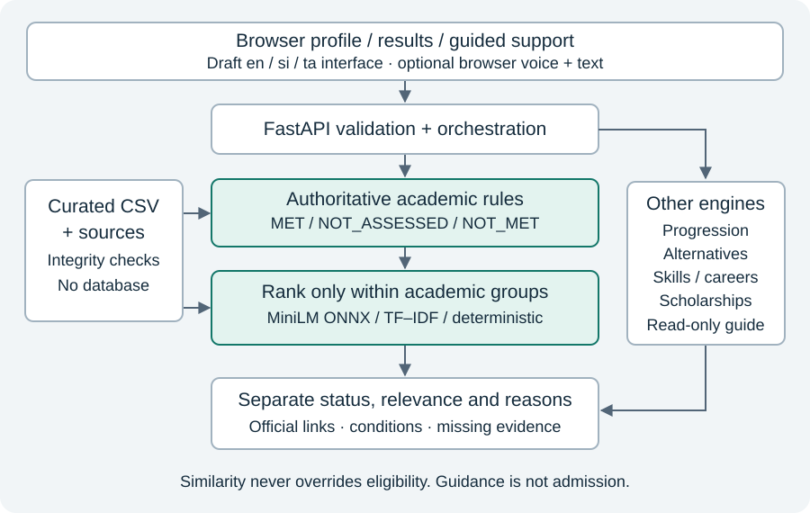

# Appendix C. Architecture and data flow

Editable sources: figures/architecture.svg and architecture.mmd. The diagram separates authoritative assessments from within-group relevance and shows the supporting engines. “Read-only guide” means a deterministic intent interface reusing engines, not a generative LLM. The optional browser speech service has separate processing/privacy behaviour from local inference.

The sequence in figures/request-flow.mmd describes the personalised request path, including model unavailable and no-preference states. The qualification-only branch returns academic_insights rather than fabricated examination recommendations. Diagrams describe actual module boundaries, not separate network microservices. All backend engines execute within the modular FastAPI application.
